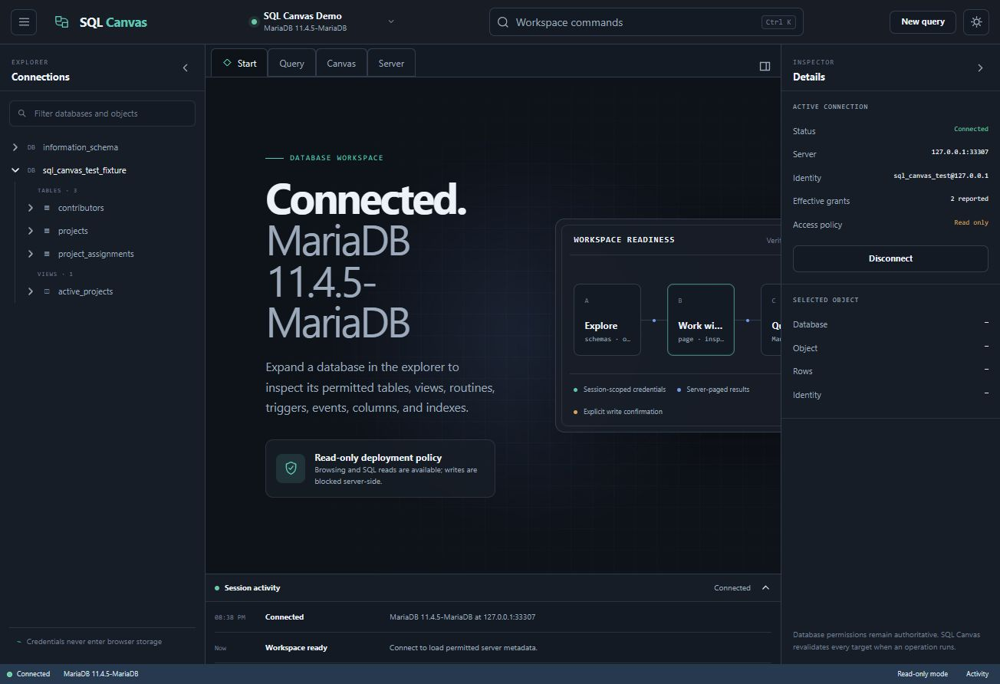
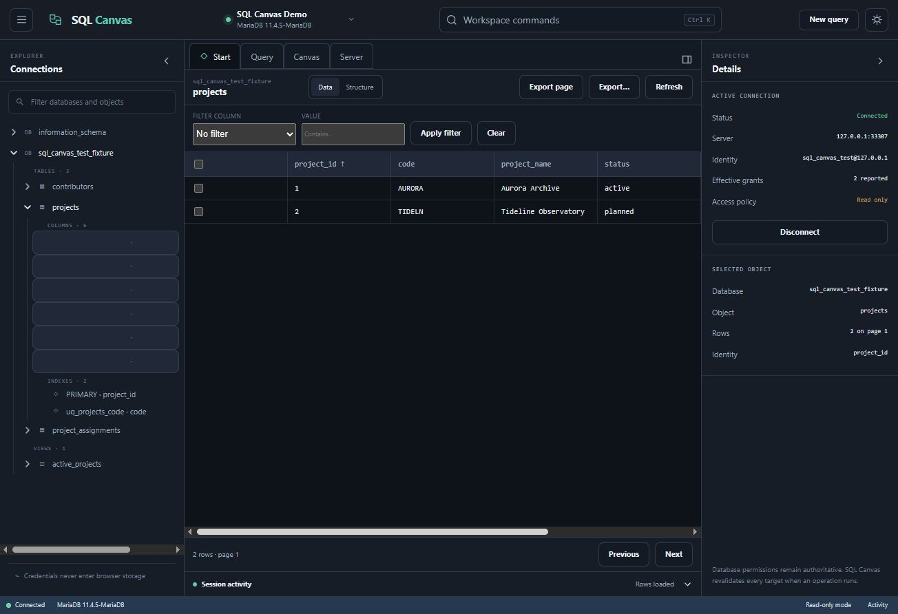
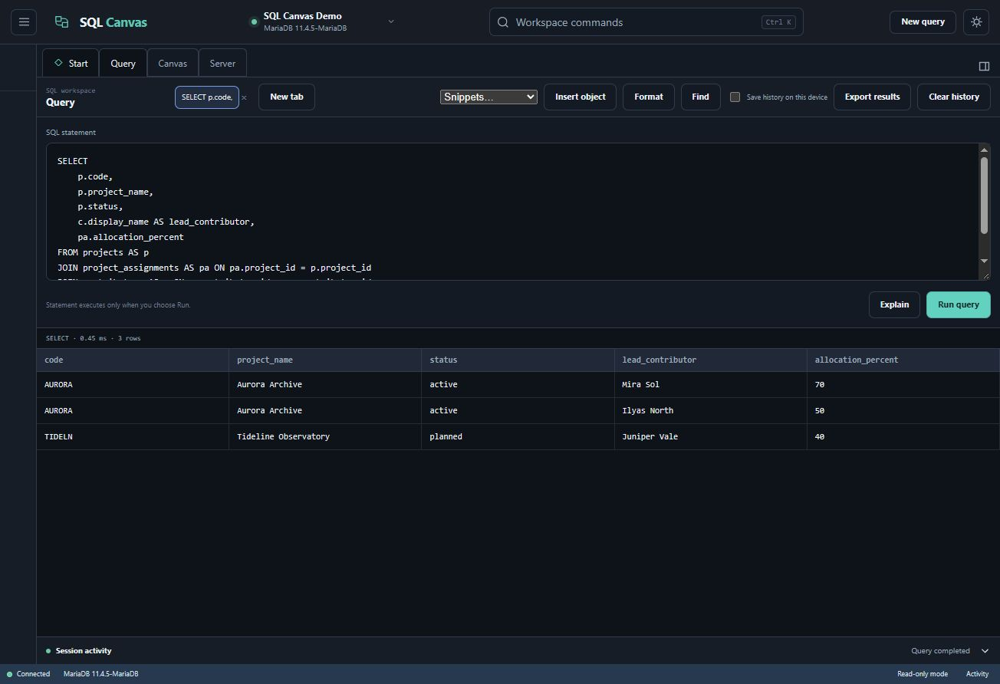
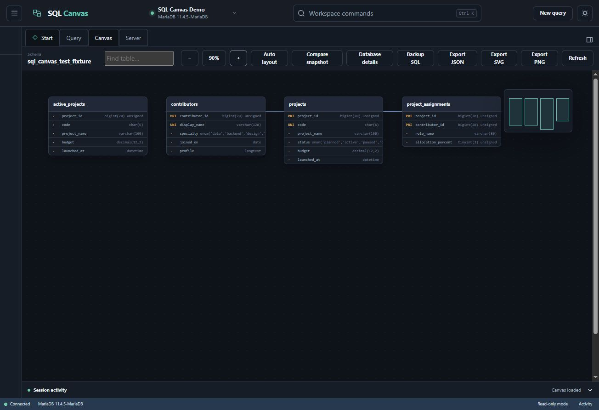

# SQL Canvas

### See your database. Understand it. Change it with confidence.

[](https://www.php.net/)
[](https://www.mysql.com/)
[](https://mariadb.org/)
[](https://github.com/shafleen/SQL-Canvas/actions/workflows/ci.yml)
[](LICENSE)

**SQL Canvas is a visual-first, self-hosted workspace for MySQL and MariaDB.** Browse data like a spreadsheet, map relationships on an interactive canvas, build and inspect schemas, run SQL, import and export data, and manage a server from one polished interface.

It runs on ordinary PHP hosting. There is no mandatory cloud account, no telemetry, no application database, no Node.js production server, and no vendor lock-in.

> Think of it as a modern database cockpit: the speed of a data grid, the clarity of a schema diagram, and the control of an administration console.

## See SQL Canvas in action

<p align="center">
  
</p>

<p align="center"><em>Connect once, then explore data, relationships, queries, and server details from a single focused workspace.</em></p>

<table>
  <tr>
    <td width="50%">
      
      <br><strong>Browse real data without losing context</strong><br>
      Filter, sort, inspect, and page through records while the object tree and table identity stay visible.
    </td>
    <td width="50%">
      
      <br><strong>Write SQL and inspect results immediately</strong><br>
      Use a multi-tab query workspace with readable results, timing, EXPLAIN support, and export tools.
    </td>
  </tr>
</table>

<p align="center">
  
</p>

<p align="center"><em>Turn foreign keys into an interactive relationship map with zoom, auto-layout, minimap, snapshots, and image export.</em></p>

## Why people choose SQL Canvas

- **Visual by default.** See tables, keys, columns, and relationships instead of mentally reconstructing a schema from menus.
- **Fast for real work.** Search, sort, filter, inspect, edit, duplicate, and export rows without leaving the workspace.
- **Power without mystery.** Schema changes show their SQL before anything runs, and destructive operations require an exact confirmation.
- **Your server, your data.** Install it on a laptop, private server, VPN, intranet, VPS, or compatible shared host.
- **Lightweight deployment.** Upload PHP, HTML, CSS, and JavaScript files. No production compilation is required.
- **Permission-aware.** SQL Canvas detects the connected account's capabilities and does not pretend unavailable actions will work.
- **Built for both MySQL and MariaDB.** The same release is tested against MySQL 8.4 and MariaDB 11.4.

## What is included

- Secure, session-only database connections
- Filterable database and object explorer
- Server-paged data grid with safe row editing
- Record inspector for wide tables
- Create and modify tables, columns, indexes, and foreign keys
- Database statistics and guarded schema/data copying
- Interactive relationship canvas with zoom, minimap, layout persistence, snapshots, and image export
- Multi-tab SQL workspace with snippets, EXPLAIN, result export, and optional local history
- CSV, JSON, and SQL import/export workflows
- Views, routines, triggers, and events browser
- User, privilege, process, status, and server-variable administration where permitted
- Dark and light themes, responsive layouts, keyboard navigation, and reduced-motion support
- Server-enforced read-only mode for safer audit or demonstration deployments

## Choose the installation that matches your situation

| Your situation | Recommended method | Difficulty |
|---|---|---|
| You only want to try SQL Canvas on your computer | [PHP local server](#option-1-run-it-on-your-own-computer) | Easiest |
| You use Windows and already have XAMPP | [XAMPP](#option-2-install-with-xampp-on-windows) | Easy |
| You manage an Ubuntu/Debian server with Apache | [Apache](#option-3-deploy-on-apache-ubuntu-or-debian) | Moderate |
| You manage an Ubuntu/Debian server with Nginx | [Nginx](#option-4-deploy-on-nginx-ubuntu-or-debian) | Moderate |
| You have cPanel or ordinary shared hosting | [cPanel/shared hosting](#option-5-deploy-on-cpanel-or-shared-hosting) | Easy to moderate |
| A team needs secure access | [Private server, VPN, or reverse proxy](#option-6-deploy-for-a-team-on-a-private-network-or-vpn) | Recommended for teams |

## Before you install

You need:

1. **PHP 8.2 or newer.** PHP must have `PDO`, `PDO_MYSQL`, JSON, and sessions enabled.
2. **A MySQL or MariaDB server.** It can be on the same computer or another permitted server.
3. **A database username and password.** Start with a restricted account whenever possible. You do not need to use `root`.
4. **The SQL Canvas files.** Download the latest ZIP from the repository's **Releases** page or clone the repository.

SQL Canvas does not create a separate application database. It connects directly to the database server you choose.

## The one security rule you must not skip

The web server's public/document-root folder must be SQL Canvas's **`public`** directory—not the project root.

Correct:

```text
/var/www/sql-canvas/           private application files
└── public/                    the only web-accessible folder
    └── index.php
```

Incorrect:

```text
Document root: /var/www/sql-canvas
```

Pointing the web server at the project root could expose configuration or source files. The instructions below show the correct arrangement for each platform.

---

## Option 1: Run it on your own computer

This is the fastest way to try SQL Canvas. The site will be available only on your computer.

### Windows

1. Install PHP 8.2 or newer if it is not already installed.
2. Download and extract SQL Canvas, for example to `C:\SQL-Canvas`.
3. Open PowerShell inside that folder.
4. Create your private configuration file:

   ```powershell
   Copy-Item config\config.example.php config\config.php
   ```

5. Open `config\config.php` in Notepad.
6. Find `allowed_connection_hosts` and enter the database hosts you want to allow. For a database on the same computer, keep `127.0.0.1`.
7. Find `allowed_connection_ports` and enter your database port. The normal MySQL/MariaDB port is `3306`.
8. Start SQL Canvas:

   ```powershell
   php -S 127.0.0.1:8080 -t public
   ```

9. Open [http://127.0.0.1:8080](http://127.0.0.1:8080) in your browser.
10. Select **Connect database** and enter your MySQL or MariaDB credentials.

Keep the PowerShell window open while using SQL Canvas. Press `Ctrl+C` in that window to stop it.

### macOS or Linux

1. Download and extract SQL Canvas.
2. Open Terminal in the extracted folder.
3. Create your private configuration file:

   ```sh
   cp config/config.example.php config/config.php
   ```

4. Edit `config/config.php` with your preferred text editor.
5. Add the database hostname and port to the allowed lists.
6. Start SQL Canvas:

   ```sh
   php -S 127.0.0.1:8080 -t public
   ```

7. Open [http://127.0.0.1:8080](http://127.0.0.1:8080).
8. Select **Connect database** and enter your credentials.

### Check that PHP is ready

Visit `http://127.0.0.1:8080/api/health`. A successful response reports that the application is healthy. If an extension is missing, enable it in `php.ini` and restart PHP.

---

## Option 2: Install with XAMPP on Windows

Use this option if you already run PHP applications through XAMPP.

1. Stop Apache in the XAMPP Control Panel if it is running.
2. Extract SQL Canvas to `C:\xampp\htdocs\sql-canvas`.
3. Copy the configuration template:

   ```powershell
   Copy-Item C:\xampp\htdocs\sql-canvas\config\config.example.php C:\xampp\htdocs\sql-canvas\config\config.php
   ```

4. Edit `config\config.php` and add only the database hosts and ports you intend to use.
5. Open `C:\xampp\apache\conf\extra\httpd-vhosts.conf` as an administrator.
6. Add this virtual host:

   ```apache
   <VirtualHost *:80>
       ServerName sql-canvas.local
       DocumentRoot "C:/xampp/htdocs/sql-canvas/public"

       <Directory "C:/xampp/htdocs/sql-canvas/public">
           Options -Indexes
           AllowOverride All
           Require local
       </Directory>
   </VirtualHost>
   ```

7. Open `C:\Windows\System32\drivers\etc\hosts` as an administrator.
8. Add this line:

   ```text
   127.0.0.1 sql-canvas.local
   ```

9. Start Apache in the XAMPP Control Panel.
10. Open [http://sql-canvas.local](http://sql-canvas.local).

`Require local` prevents other computers from opening the application. If you intentionally need LAN access, use a firewall, HTTPS, authentication, and a private network instead of simply removing that protection.

---

## Option 3: Deploy on Apache, Ubuntu, or Debian

These steps assume you can run commands with `sudo`.

1. Install Apache, PHP, and the MySQL extension:

   ```sh
   sudo apt update
   sudo apt install apache2 php php-mysql libapache2-mod-php unzip
   ```

2. Upload or extract SQL Canvas to `/var/www/sql-canvas`.
3. Create the private configuration:

   ```sh
   cd /var/www/sql-canvas
   sudo cp config/config.example.php config/config.php
   sudo nano config/config.php
   ```

4. Add the permitted database hosts and ports. Save with `Ctrl+O`, press Enter, then exit with `Ctrl+X`.
5. Create an Apache site:

   ```sh
   sudo nano /etc/apache2/sites-available/sql-canvas.conf
   ```

6. Paste the following, replacing the domain name if needed:

   ```apache
   <VirtualHost *:80>
       ServerName sql-canvas.internal.example
       DocumentRoot /var/www/sql-canvas/public

       <Directory /var/www/sql-canvas/public>
           Options -Indexes
           AllowOverride All
           Require all granted
       </Directory>

       ErrorLog ${APACHE_LOG_DIR}/sql-canvas-error.log
       CustomLog ${APACHE_LOG_DIR}/sql-canvas-access.log combined
   </VirtualHost>
   ```

7. Enable the site and required Apache module:

   ```sh
   sudo a2enmod rewrite
   sudo a2ensite sql-canvas.conf
   sudo apache2ctl configtest
   sudo systemctl reload apache2
   ```

8. Add HTTPS using your organization's certificate or a trusted certificate provider.
9. Open `https://sql-canvas.internal.example/api/health` and confirm the health check passes.
10. Open the main site and connect using a restricted database account.

The ready-made example is in [`deploy/apache-vhost.conf`](deploy/apache-vhost.conf).

---

## Option 4: Deploy on Nginx, Ubuntu, or Debian

1. Install Nginx, PHP-FPM, and the MySQL extension:

   ```sh
   sudo apt update
   sudo apt install nginx php-fpm php-mysql unzip
   ```

2. Upload or extract SQL Canvas to `/var/www/sql-canvas`.
3. Create and edit the private configuration:

   ```sh
   cd /var/www/sql-canvas
   sudo cp config/config.example.php config/config.php
   sudo nano config/config.php
   ```

4. Create an Nginx site:

   ```sh
   sudo nano /etc/nginx/sites-available/sql-canvas
   ```

5. Paste this configuration:

   ```nginx
   server {
       listen 80;
       server_name sql-canvas.internal.example;
       root /var/www/sql-canvas/public;
       index index.php;

       location / {
           try_files $uri $uri/ /index.php?$query_string;
       }

       location ~ ^/index\.php$ {
           include fastcgi_params;
           fastcgi_param SCRIPT_FILENAME $document_root$fastcgi_script_name;
           fastcgi_pass unix:/run/php/php8.2-fpm.sock;
       }

       location ~ \.php$ { return 404; }
       location ~ /\. { deny all; }
   }
   ```

6. Check the installed PHP socket name with `ls /run/php/`. If your socket is not `php8.2-fpm.sock`, update the `fastcgi_pass` line.
7. Enable and test the site:

   ```sh
   sudo ln -s /etc/nginx/sites-available/sql-canvas /etc/nginx/sites-enabled/sql-canvas
   sudo nginx -t
   sudo systemctl reload nginx
   ```

8. Add HTTPS before allowing other people to use the site.
9. Visit `https://sql-canvas.internal.example/api/health`.
10. Open the main site and connect to the database.

The ready-made example is in [`deploy/nginx.conf`](deploy/nginx.conf).

---

## Option 5: Deploy on cPanel or shared hosting

Use this only if the hosting provider supports PHP 8.2+, PDO MySQL, PHP sessions, and a custom document root.

1. Download the latest SQL Canvas release ZIP.
2. Sign in to cPanel and open **File Manager**.
3. Create a folder outside `public_html`, such as `/home/your-account/sql-canvas`.
4. Upload and extract the ZIP into that folder.
5. Copy `config/config.example.php` to `config/config.php` using File Manager.
6. Edit `config/config.php` and add the database hostname and port supplied by your host.
7. In cPanel, create a subdomain such as `sql.example.com`.
8. Set that subdomain's document root to `/home/your-account/sql-canvas/public`.
9. Use **MultiPHP Manager** or the equivalent screen to select PHP 8.2 or newer.
10. Enable SSL/TLS for the subdomain.
11. Protect the subdomain with cPanel directory privacy, your hosting provider's access control, or another authentication layer.
12. Visit `https://sql.example.com/api/health`.

Do not use shared hosting if it forces the project root to be public or prevents you from protecting the administration site. Ask the provider before uploading if you are unsure.

---

## Option 6: Deploy for a team on a private network or VPN

This is the recommended arrangement for a business or technical team.

1. Install SQL Canvas using the Apache or Nginx instructions above.
2. Give the server a private DNS name such as `sql-canvas.company.internal`.
3. Make the site reachable only through a company VPN, private LAN, zero-trust access gateway, authenticated reverse proxy, or firewall allowlist.
4. Enable HTTPS even on the internal network.
5. Keep `read_only` enabled for users who only need to inspect data.
6. Create restricted database accounts for different responsibilities rather than sharing a server administrator password.
7. Allow the database firewall to accept connections from the SQL Canvas server—not from every employee computer.
8. Review the project-local audit log and the database server's own audit facilities according to your organization's policy.

```text
User browser
    │ HTTPS + company authentication
    ▼
VPN / access gateway / reverse proxy
    │
    ▼
SQL Canvas PHP server
    │ restricted database account + verified TLS
    ▼
MySQL or MariaDB
```

## Configure allowed database destinations

Open `config/config.php` and find:

```php
'allowed_connection_hosts' => ['127.0.0.1'],
'allowed_connection_ports' => [3306],
```

Examples:

```php
// Database on the same server
'allowed_connection_hosts' => ['127.0.0.1'],
'allowed_connection_ports' => [3306],
```

```php
// One internal database server
'allowed_connection_hosts' => ['db.company.internal'],
'allowed_connection_ports' => [3306],
```

```php
// Two explicitly approved servers
'allowed_connection_hosts' => ['db-primary.company.internal', 'db-reporting.company.internal'],
'allowed_connection_ports' => [3306],
```

An empty host or port list denies every connection. Wildcards are not used. For remote databases, keep `require_tls_for_remote` set to `true`, configure a CA certificate readable by PHP, and select verified TLS in the connection dialog.

## Choose read-only or write-enabled operation

The default configuration is read-only:

```php
'read_only' => true,
```

This is ideal for evaluation, reporting, support, and schema inspection. To permit database changes:

```php
'read_only' => false,
```

Changing this setting does not grant database permission. The connected MySQL/MariaDB account must still be authorized by the database server. Start with read-only mode and a restricted account; enable writes only after testing backups and access controls.

## First connection

1. Open SQL Canvas.
2. Select **Connect database**.
3. Enter a friendly connection name, such as `Reporting database`.
4. Enter the approved hostname and port.
5. Enter the database username and password.
6. Optionally enter a default database name.
7. Select verified TLS for a remote connection.
8. Select **Connect**.

Credentials remain in the protected PHP session and are not saved in browser storage. Select **Disconnect** when finished.

## Common problems

### “Destination not allowed”

The hostname or port is not listed in `config/config.php`. Add the exact destination and try again.

### “Could not find driver”

The PHP PDO MySQL extension is missing. Enable or install `pdo_mysql`, then restart the web server.

### The page loads, but styles or API calls fail

Confirm that the document root points to `sql-canvas/public`, not the project folder above it.

### Nginx shows “502 Bad Gateway”

Check the PHP-FPM socket with `ls /run/php/` and make the `fastcgi_pass` value match it.

### Connection works locally but not from the server

Check the database firewall, MySQL/MariaDB bind address, the database user's permitted host, DNS, and TLS settings.

### A button is missing

SQL Canvas hides certain operations when the connected account lacks the corresponding permission. Review the account's grants instead of using a more powerful account by default.

## Security checklist

- Serve only the `public/` directory.
- Use HTTPS for every non-local deployment.
- Place the site behind a VPN, private network, or strong access gateway.
- Use least-privilege database accounts.
- Keep `config/config.php` private and out of source control.
- Keep remote TLS verification enabled.
- Protect PHP session storage and `storage/` from web access.
- Test `/api/health` after deployment.
- Verify that `/config`, `/src`, `/tests`, and `/storage` cannot be opened in a browser.
- Use native database backup tools before enabling destructive operations.

Read the full [security guide](docs/SECURITY.md) before a production deployment.

## Verified compatibility

| Component | Verified version |
|---|---|
| PHP | 8.5.12 locally; CI targets 8.2, 8.3, 8.4, and 8.5 |
| MySQL | 8.4.13 |
| MariaDB | 11.4.5 |
| Browser | Current evergreen browsers |

No MySQL 5.7 compatibility claim is made.

## Current boundaries

- One active database connection is supported per browser session.
- Browser transfers are deliberately bounded and are not a replacement for `mysqldump`, `mariadb-dump`, physical backups, or specialist bulk loaders.
- Complex routines, triggers, and events can be edited in the SQL workspace, where the database server remains the syntax authority.
- Stopping a browser request does not guarantee that a database server query has been cancelled; server timeouts remain authoritative.

See the detailed [feature matrix](docs/FEATURE_MATRIX.md).

## Development

Production hosting does not require Composer or Node.js. Contributors can run:

```sh
composer install
composer lint
composer test -- --exclude-group database
npm test
```

Disposable MySQL and MariaDB fixtures are defined in `docker-compose.test.yml`. They use fictional data, localhost-only ports, and temporary storage. Never point the fixture reset tool at an operational database.

Useful technical documents:

- [Architecture](docs/ARCHITECTURE.md)
- [API conventions](docs/API.md)
- [Installation notes](docs/INSTALL.md)
- [Security guide](docs/SECURITY.md)
- [Accessibility checklist](docs/ACCESSIBILITY_CHECKLIST.md)
- [Contributing](CONTRIBUTING.md)

## Contributing

Bug reports, focused improvements, documentation fixes, accessibility work, and compatibility testing are welcome. Please read [CONTRIBUTING.md](CONTRIBUTING.md) before opening a pull request.

## License

SQL Canvas is available under the [MIT License](LICENSE).

---

**If SQL Canvas makes database work clearer for you, star the repository and share it with someone still fighting a maze of database administration tabs.**
